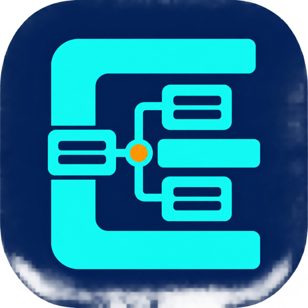

# EXPRESSsuite



A Visual Studio Code extension that provides language support and rich-content viewers for the [EXPRESS (ISO 10303-11)](https://www.iso.org/standard/38047.html) information modeling language used by ISO TC 184/SC 4 STEP standards.

EXPRESSsuite is an independently maintained derivative of the NIST-developed
[easyEXPRESS](https://github.com/usnistgov/easy-express) (Sylvere Krima,
Allison Barnard Feeney, Rosemary Astheimer; U.S. National Institute of
Standards and Technology). EXPRESSsuite has its own product and Visual Studio
Marketplace identity, `TRThurman.expresssuite`; it is not the NIST-owned
easyEXPRESS application or listing. Pursuant to NIST's
[Software Licensing Statement](LICENSE.md), this project carries a notice of
modifications in [`NOTICE.md`](NOTICE.md) and acknowledges NIST as the source
of the original software. NIST-developed software is not subject to copyright
protection within the United States under 17 U.S.C. § 105.

If you reference, cite, or build on this work, see [§ Citation](#citation) below or the machine-readable [`CITATION.cff`](CITATION.cff).

## Features

### Language support (existing)

- Syntax highlighting and validation for `.exp` files.
- [IntelliSense](https://code.visualstudio.com/docs/editor/intellisense) with auto-completion of entities, types, and attributes.
- [Code navigation](https://code.visualstudio.com/docs/editor/editingevolved): Go to Definition, Peek Definition, Find All References, Go to Symbol.
- [Refactoring](https://code.visualstudio.com/docs/editor/refactoring): Rename Symbol with cross-file scope tracking.
- Code snippets for common EXPRESS patterns.

### SC4 validation

EXPRESSsuite reports additional ISO TC 184/SC 4 authoring problems in the
standard VS Code **Problems** view:

- **Entity-name case is significant (project requirement)** — EXPRESSsuite
  is tailored for ISO 10303 development, where the case of an entity name
  carries meaning: ARM entity names begin with an uppercase letter
  (`Product`), MIM and integrated-resource entity names are lowercase
  (`product`), and the two are different entities. References bind only to
  the exact spelling, so `SUBTYPE OF (mesh)` does not name `ENTITY Mesh`, and
  an ARM reference written in lowercase is an error in the ARM. This is a
  deliberate project departure from ISO 10303-11:2004 7.1.2, which makes
  letter case insignificant outside string literals (project ruling,
  2026-10-29). The published SMRLv8 follows the convention without exception
  in its ARMs (3,460 of 3,460 entity names) and MIMs (1,359 of 1,359).
- **Schema-name case (project requirement)** — a schema whose name ends in
  `arm` or `mim` begins with an uppercase letter (`Mesh_topology_arm`,
  `Mesh_topology_mim`; project ruling, 2026-10-30). The published SMRLv8
  follows this in every module `arm.exp` and `mim.exp` (1,735 ARM and 1,737
  MIM schema names); the only exceptions are 104 lowercase copies in
  `modules/analytical_model/arm_concatenated.exp` and `mim_concatenated.exp`.
  Schema names that do not end in `arm` or `mim` are uncontrolled (project
  ruling, 2026-10-30). A schema reference (`USE FROM`, `REFERENCE FROM`)
  binds only to the exact spelling, as an entity reference does, so
  `REFERENCE FROM GEOMETRY_SCHEMA` does not name `geometry_schema` (project
  ruling, 2026-10-30). No diagnostic checks the naming rule yet.
- **Case is not significant in type, attribute, function, rule and
  subtype-constraint names (project requirement)** — two spellings that
  differ only in case denote the same declaration, as ISO 10303-11:2004 7.1.2
  provides; only entity names and the schema-name rule above carry case
  (project ruling, 2026-10-30). Known gap: the linker still binds type and
  attribute references to the exact spelling (in SMRLv8, 3 type and 23
  attribute references fail only by case). The casing diagnostics below are
  style hints and remain.
- **Declaration-name casing** — entities in schemas whose names end in
  `_arm` must begin with an uppercase letter. Entities in other schemas and
  all type names must be lowercase. Casing diagnostics include a quick fix.
- **Duplicate interfaced declarations** — within one schema's scope an
  identifier may be declared or explicitly interfaced once only (ISO
  10303-11:2004 10.1 b). `duplicate-interfaced-declaration` is reported in
  every schema in whose scope one identifier denotes two different
  declarations of any kind, whether both are local, one is interfaced, or
  both arrive through `USE FROM` chains; it is anchored at the local
  declaration or at the interface line that brought the declaration in, with
  related information at every declaration. The scope follows clause 11: a
  `USE FROM` re-exports along chains and under renames (11.1, 11.3), a
  `REFERENCE FROM` sees what the foreign schema declares or use's but never
  chains (11.2, 11.3), explicit item lists are honoured, one declaration
  reached by several routes counts once, and implicit interfaces bring no
  identifier (11.4). In a short form an entity name is case-significant and
  every other kind is compared without regard to case (project rulings); in a
  long form (`_lf`) every identifier is compared without regard to case and
  identical repeated definitions are the warning `redundant-declaration`
  (WG11 N239). The scope relation is proved in
  `lean/ExpressSuite/Interfaces.lean`.
- **Duplicate loop indices** — a `LOCAL` variable must not redeclare the
  index implicitly declared by a `REPEAT` increment control. Loop-index and
  variable names are compared without regard to case.
- **Informal proposition signatures** — annotations such as
  `(*"schema.entity.wr:IP1" ... *)` must have a matching `--IP1:` signature
  as the final entry inside the corresponding `ENTITY` or `TYPE`. Missing,
  malformed, misplaced, and unmatched signatures are reported, as are
  malformed `.IPn` and `.ipn` annotation keys.

- **Attribute redeclaration types** — the type of `SELF\e.attr : T` must be
  the same as, or a specialization of, the original attribute's type
  (ISO 10303-11:2004 9.2.3.4, 9.2.7). Defined types and selects are seen
  through on both sides, so narrowing `compound_item_definition` to a
  `LIST [2:3] OF point_and_vector_member` is accepted, while `LIST OF REAL` is
  not. The relation is proved sound in `lean/`.
- **Index qualifiers** — `x[1]` is reported when the declared type of `x` can
  never hold an aggregate value (ISO 10303-11:2004 12.6.1).
- **Ambiguous attribute references** — `x.a` is reported when `a` is declared
  by two or more entities at the same nearest depth of the declared type of
  `x` (ISO 10303-11:2004 12.7.3, last sentence); qualify it with a group
  reference such as `x\e.a`.

Attribute references resolve as 12.7.3 prescribes: `x.a` is looked up in the
declared type of `x`, its supertypes and its subtypes, nearest first, never in
a sibling entity; `x\e` may name any entity in the same subtype/supertype
graph (12.7.4) and `x\e.a` then means `e`'s own declaration. Hover,
go-to-definition, completion and validation all follow this one rule, which
is proved against the clause text in `lean/`.

The same check is available on demand as **EXPRESSsuite: Detect Duplicate
Declarations in Schema Closure** from the Command Palette or an EXPRESS
editor's context menu: it lists the clashes in the scope of the schema at the
cursor, computed by the same scope index as the live diagnostic, handles cycles
and renamed resources, and publishes navigable diagnostics for declaration
names supplied by more than one schema in that closure.

### Annotation viewers (new in 0.4.0)

Four surfaces that render the [annotated EXPRESS](https://github.com/metanorma/annotated-express) convention used by SC 4 schema authors — Metanorma AsciiDoc inside `(*"tag" body *)` named-remark comments:

- **Hover provider** — rich `MarkdownString` popups showing the description of the entity at the cursor, with cross-references rendered as clickable links and embedded math (`stem:[…]`) shown as inline SVG glyphs.
- **Show Description** — a webview panel beside the editor with the full description rendered via Asciidoctor.js, with embedded math typeset via Plurimath (the same converter Metanorma uses).
- **Show EXPRESS-G Diagram** — interactive SVG viewer for `<schema>expg<N>.svg` diagrams; click any labelled box to jump to the entity's source declaration.
- **AsciiMath Playground** — live-preview webview for AsciiMath input. Renders prose-with-math fragments in place; supports `stem:[…]` (AsciiMath) and `latexmath:[…]` (LaTeX). "Insert at cursor" pastes the source as `stem:[…]` into the active editor.

> Note to STEP developers: long-form and concatenated files are not currently supported.

## Install

### From a packaged `.vsix`

```
code --install-extension expresssuite-0.4.0.vsix
```

The package installs as `TRThurman.expresssuite`. It does not replace or
publish a new version under the NIST easyEXPRESS Marketplace identity.

(Use `code-insiders --install-extension …` for VS Code Insiders.) Reload the window after install. The extension activates on the first `.exp` file encountered in the workspace.

### From source (development)

```
git clone https://github.com/TRThurman/EXPRESSsuite.git
cd EXPRESSsuite
npm ci
npm run build
```

To launch a development host with the extension loaded:

```
code --extensionDevelopmentPath="$(pwd)" --disable-extensions
```

To package a `.vsix` from source:

```
npm i -g @vscode/vsce
vsce package
```

## Quick start

Open any `.exp` file with named-remark annotations (e.g. those in [wg12-step](https://sd.iso.org/bitbucket-pilot/scm/isotc184sc4/wg12-step.git)). The four viewer surfaces are reachable as:

| Surface | Trigger |
|---|---|
| Hover description | hover the cursor on any entity name |
| Show Description | right-click → **Show Description** (or command palette) |
| Show EXPRESS-G Diagram | right-click → **Show EXPRESS-G Diagram** |
| AsciiMath Playground | command palette → **EXPRESSsuite: Open AsciiMath Playground** |
| Send Selection to Playground | select text in editor → right-click → **Send Selection to AsciiMath Playground** |
| Detect duplicate declarations | place the cursor in a schema → command palette or right-click → **Detect Duplicate Declarations in Schema Closure** |

Performance and diagnostic logs land in the **Output** panel under **EXPRESSsuite**.

## Privacy and confidentiality

EXPRESSsuite itself makes **zero outbound network calls**. Every webview is configured with CSP `connect-src 'none'`; the extension host source contains no `fetch`, no `http(s)` import, no telemetry. Math rendering happens entirely on your machine via Plurimath (in a `node:worker_threads` worker) and MathJax (lazy-loaded for hover SVGs).

> ⚠ However, modern VS Code (and especially VS Code Insiders) bundles **GitHub Copilot Chat** as a built-in feature. Its right-click context-menu entries (**Explain**, **Add File to Chat**, **Open Inline Chat**, **Review**) DO send the cursor word, enclosing scope, surrounding source lines, and snippets from other open editors to GitHub/Microsoft endpoints. `--disable-extensions` does NOT remove these.

For pre-publication standards work under non-disclosure, the recommended workflow is:

1. **Sign out of GitHub** in the affected VS Code window (account icon at bottom-left → Sign Out). Without auth, Copilot Chat cannot reach its API.
2. Or set **`"chat.disableAIFeatures": true`** in the workspace's `.vscode/settings.json`.
3. Best practice: a dedicated, signed-out window for any sensitive schema work; sign back in for non-confidential projects.

The companion white paper (see below) documents the data flows and verification steps in detail.

## Documentation

Project documentation under [`docs/`](docs/):

| Path | Audience |
|---|---|
| [`docs/easyEXPRESS-viewers.adoc`](docs/easyEXPRESS-viewers.adoc) | Technical white paper (architecture, security model, data privacy, performance) |
| [`docs/easyEXPRESS-viewers.pptx`](docs/easyEXPRESS-viewers.pptx) | Implementor-oriented PowerPoint deck (21 slides) |
| [`docs/easyEXPRESS-viewers-user-guide.pptx`](docs/easyEXPRESS-viewers-user-guide.pptx) | User-oriented PowerPoint deck (19 slides, screenshot-led) |
| [`docs/smoke-test-checklist.md`](docs/smoke-test-checklist.md) | Cross-platform manual smoke-test plan (S1–S6 + per-schema acceptance) |
| [`DESIGN-viewers-integration.md`](DESIGN-viewers-integration.md) | Full design protocol document (Phase 0 reconnaissance → Phase 4 validation) |
| [`CHANGELOG.md`](CHANGELOG.md) | Release notes |

### Rendering the white paper

The white paper is written in AsciiDoc to dogfood the format the extension renders. To preview it:

#### As HTML — in VS Code

Install the [Asciidoctor extension for VS Code](https://marketplace.visualstudio.com/items?itemName=asciidoctor.asciidoctor-vscode):

```
code --install-extension asciidoctor.asciidoctor-vscode
```

Open `docs/easyEXPRESS-viewers.adoc`, then **`Cmd+K V`** (preview to the side) or **`Cmd+Shift+V`** (preview in the same column). The preview updates as the file is edited.

#### As HTML — from the command line

```
asciidoctor docs/easyEXPRESS-viewers.adoc -o docs/easyEXPRESS-viewers.html
open docs/easyEXPRESS-viewers.html
```

#### As PDF

```
gem install asciidoctor-pdf
asciidoctor-pdf docs/easyEXPRESS-viewers.adoc -o docs/easyEXPRESS-viewers.pdf
open docs/easyEXPRESS-viewers.pdf
```

#### As Metanorma standoc (publication fidelity)

```
gem install metanorma-cli metanorma-standoc
metanorma compile docs/easyEXPRESS-viewers.adoc -t standoc -x html,pdf
```

This path uses Plurimath to render embedded math, exactly matching the rendering the extension itself produces.

## Build, lint, test

```
npm run build      # langium-generate + tsc + esbuild
npm run lint       # eslint
npm test           # vitest (98 tests)
npm run rebuild    # clean build from scratch
```

Continuous integration runs the build/lint/test matrix on macOS, Ubuntu, and Windows via [`.github/workflows/ci.yaml`](.github/workflows/ci.yaml). The workflow uploads platform-specific `.vsix` artifacts on each push.

## Origin and licensing

The original **easyEXPRESS** was developed at the U.S. National Institute of Standards and Technology by **Sylvere Krima**, **Allison Barnard Feeney**, and **Rosemary Astheimer**. The original NIST-developed software is not subject to copyright protection within the United States under 17 U.S.C. § 105. The complete NIST Software Licensing Statement is preserved in [`LICENSE.md`](LICENSE.md).

In compliance with NIST's stated requirement that *modified works should carry a notice stating that you changed the software and should note the date and nature of any such change*, this repository includes [`NOTICE.md`](NOTICE.md) summarising the modifications since the fork point.

This fork is maintained by **Thomas Thurman** (TRThurman Consulting) under the [MIT License](LICENSE) for code originating in this fork.

## Citation

If you use this software in academic, standards, or regulatory work, please cite both:

**The NIST original** (the substrate this work builds on):

> Krima, S., Barnard Feeney, A., and Astheimer, R. *easyEXPRESS: A Visual Studio Code Extension for ISO 10303-11.* U.S. National Institute of Standards and Technology, 2024. https://github.com/usnistgov/easy-express. Public-domain in the U.S. under 17 U.S.C. § 105.

**This fork** (when the modifications are material to the work cited):

> Thurman, T. *EXPRESSsuite.* TRThurman Consulting, 2025–. https://github.com/TRThurman/EXPRESSsuite. MIT-licensed for code originating in this derivative.

A machine-readable [Citation File Format](https://citation-file-format.github.io/) entry is provided as [`CITATION.cff`](CITATION.cff). GitHub renders this as a "Cite this repository" button on the repository home page; tools such as Zenodo and CFF-aware reference managers consume it directly.

> If you have downstream-renamed or rebadged this software (e.g. as a derivative product with a different name), the citation requirement still applies to both the NIST original and this intermediate fork; see [`NOTICE.md`](NOTICE.md) for the chain of attribution.

## Contributing

For bug reports and feature requests, please [open an issue](https://github.com/TRThurman/EXPRESSsuite/issues).

For code contributions, the development workflow is:

1. Fork the repository and create a topic branch.
2. Make changes; ensure `npm run lint` and `npm test` pass.
3. Open a pull request against `main`.

Larger changes (new viewer surfaces, parser changes, security model adjustments) are guided by the design protocol document — see [`DESIGN-viewers-integration.md`](DESIGN-viewers-integration.md) for the phased process used for the 0.4.0 release.
