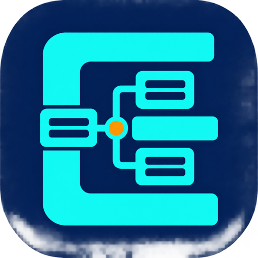

# EXPRESSsuite



A Visual Studio Code extension that provides language support and rich-content viewers for the [EXPRESS (ISO 10303-11)](https://www.iso.org/standard/38047.html) information modeling language used by ISO TC 184/SC 4 STEP standards.

EXPRESSsuite is an independently maintained derivative of the NIST-developed
[easyEXPRESS](https://github.com/usnistgov/easy-express) (Sylvere Krima,
Allison Barnard Feeney, Rosemary Astheimer; U.S. National Institute of
Standards and Technology). EXPRESSsuite has its own product and Visual Studio
Marketplace identity, `TRThurman.expresssuite`; it is not the NIST-owned
easyEXPRESS application or listing. Pursuant to NIST's
[Software Licensing Statement](LICENSE.md), this project carries a notice of
modifications in [`NOTICE.md`](NOTICE.md) and acknowledges NIST as the source
of the original software. NIST-developed software is not subject to copyright
protection within the United States under 17 U.S.C. § 105.

If you reference, cite, or build on this work, see [§ Citation](#citation) below or the machine-readable [`CITATION.cff`](CITATION.cff).

## Features

### Language support (existing)

- Syntax highlighting and validation for `.exp` files.
- [IntelliSense](https://code.visualstudio.com/docs/editor/intellisense) with auto-completion of entities, types, and attributes.
- [Code navigation](https://code.visualstudio.com/docs/editor/editingevolved): Go to Definition, Peek Definition, Find All References, Go to Symbol.
- [Refactoring](https://code.visualstudio.com/docs/editor/refactoring): Rename Symbol with cross-file scope tracking.
- Code snippets for common EXPRESS patterns.

### Describe Declaration

The **Describe Declaration** command (right-click menu or command palette)
writes the description block of a declaration after `END_SCHEMA;` from a
selected comment, typed text or the clipboard. It proposes links, appends the
OPTIONAL sentence to optional attributes, shows the edit in the refactor
preview, and is undone in one step. A check reports description blocks with
undeclared links, unkeyed remarks and blocks inside a schema.

The tutorial and its demo schemas are part of the extension: run
**EXPRESSsuite: Open Tutorial** from the command palette (the Welcome page
lists it under Walkthroughs). It opens a copy of the demo in a window of its
own with the tutorial beside it. The same text is in the repository:
[`docs/tutorial/describe-declarations.md`](docs/tutorial/describe-declarations.md).

### From a description to the EXPRESS

In a description block after `END_SCHEMA;`, **Go to Definition** (F12,
Cmd+click or Ctrl+click) goes to the EXPRESS that the text under the cursor
names:

| Cursor on | Goes to |
|---|---|
| a part of the key `(*"schema.entity.attribute"` | the schema, the entity or the attribute, by the part under the cursor |
| a key of a type, function, procedure, rule, subtype constraint or constant | that declaration |
| a key of an enumeration item or a parameter | the item or the parameter |
| a key ending in `wr:label` or `ur:label` | the WHERE or UNIQUE rule |
| a key ending in `wr:IPn` | the `--IPn:` line of the informal proposition |
| a key ending in `.__note`, `.__example`, `.__figure`, `.__table` | where the key without the suffix goes |
| an `<<express:schema.name,text>>` cross-reference | its target, in any file of the workspace |
| a plain name or the bold subject `**name**` | the member, the declaration of the schema, or the one it reaches through its interfaces |

The **Show Description** panel has a **Go to declaration** link under its
heading for the same step from the rendered text.

### References and Rename with the descriptions

**Find All References** (Shift+F12) and **Rename** (F2) include the
description blocks after `END_SCHEMA;`, in every file of the workspace, and
start from the EXPRESS, from a key or from a cross-reference.

| Place that names the declaration | Find All References | Rename |
|---|---|---|
| EXPRESS: the declaration and its uses | listed | changed |
| the part of a key that names it, also before `.__note` and the other suffixes | listed | changed |
| the target of an `<<express:...>>` cross-reference | listed | changed |
| the display text of a cross-reference | not listed | changed only when it is exactly the old name |
| the name written in the text of a block | listed | not changed |

An attribute and the attributes that redeclare it without `RENAMED` go
together. A name in the text is listed when it would resolve to the
declaration by the rule of Go to Definition above; for a name that is also an
ordinary word, such as `point`, the list is long.

### Type-ahead in a description block

In a keyed description block after `END_SCHEMA;` the completion list offers
what is valid where the cursor stands. It opens by itself after `"`, `.`, `:`
and `**`.

| Cursor | Offered |
|---|---|
| in a key | the schema; after `schema.` its declarations, those without a block first, then the roles (`.__note`, `.__example`, ...); after `schema.owner.` the owner's members, its rules (`wr:label`, `ur:label`, `wr:IPn`) and the roles |
| after `<<express:` | the schemas: this one, those it interfaces, then the others; after `schema.` what it declares and what it reaches through its interfaces (written under the declaring schema); after `schema.owner.` the owner's attributes, items or parameters |
| after `**` | the name of the block's subject |
| elsewhere in the text | on Ctrl+Space only: the members of the subject, then the names of the schema |

An accepted cross-reference is completed with its display text, the name in
words, selected for typing over: `<<express:demo_widgets.mount,mount>>`. An
entry shows the description of its target when the target has one. The
completion list in the EXPRESS of a schema is unchanged.

### SC4 validation

EXPRESSsuite reports additional ISO TC 184/SC 4 authoring problems in the
standard VS Code **Problems** view:

- **Entity-name case is significant (project requirement)** — EXPRESSsuite
  is tailored for ISO 10303 development, where the case of an entity name
  carries meaning: ARM entity names begin with an uppercase letter
  (`Product`), MIM and integrated-resource entity names are lowercase
  (`product`), and the two are different entities. In a short form,
  references bind only to the exact spelling, so `SUBTYPE OF (mesh)` does not
  name `ENTITY Mesh`, and an ARM reference written in lowercase is an error
  in the ARM. This is a deliberate project departure from ISO 10303-11:2004
  7.1.2, which makes letter case insignificant outside string literals
  (project ruling, 2026-10-29). The published SMRLv8 follows the convention
  without exception in its ARMs (3,460 of 3,460 entity names) and MIMs
  (1,359 of 1,359). In a long form (a schema whose name ends in `_lf`),
  which WG11 N239 makes unique regardless of case for tools that fold case,
  every name binds regardless of case (project ruling, 2026-10-30).
- **Schema-name case (project requirement)** — a schema whose name ends in
  `arm` or `mim` begins with an uppercase letter (`Mesh_topology_arm`,
  `Mesh_topology_mim`; project ruling, 2026-10-30). The published SMRLv8
  follows this in every module `arm.exp` and `mim.exp` (1,735 ARM and 1,737
  MIM schema names); the only exceptions are 104 lowercase copies in
  `modules/analytical_model/arm_concatenated.exp` and `mim_concatenated.exp`.
  Schema names that do not end in `arm` or `mim` are uncontrolled (project
  ruling, 2026-10-30). A schema reference (`USE FROM`, `REFERENCE FROM`)
  binds only to the exact spelling, as an entity reference does, so
  `REFERENCE FROM GEOMETRY_SCHEMA` does not name `geometry_schema` (project
  ruling, 2026-10-30). No diagnostic checks the naming rule yet.
- **Case is not significant in type, attribute, function, rule and
  subtype-constraint names (project requirement)** — two spellings that
  differ only in case denote the same declaration, as ISO 10303-11:2004 7.1.2
  provides; only entity names and the schema-name rule above carry case
  (project ruling, 2026-10-30). The linker binds accordingly: an exact match
  first, otherwise a match regardless of case among the kinds that do not
  carry case, so `SELF\Value_with_unit.Unit` names the attribute `unit` and
  `x : Unit_kind` names `TYPE unit_kind`, while `SUBTYPE OF (mesh)` still
  does not name `ENTITY Mesh` in a short form. The casing diagnostics below
  are style hints and remain.
- **Declaration-name casing** — entities in schemas whose names end in
  `_arm` must begin with an uppercase letter. Entities in other schemas and
  all type names must be lowercase. Casing diagnostics include a quick fix.
- **Duplicate interfaced declarations** — within one schema's scope an
  identifier may be declared or explicitly interfaced once only (ISO
  10303-11:2004 10.1 b). `duplicate-interfaced-declaration` is reported in
  every schema in whose scope one identifier denotes two different
  declarations of any kind, whether both are local, one is interfaced, or
  both arrive through `USE FROM` chains; it is anchored at the local
  declaration or at the interface line that brought the declaration in, with
  related information at every declaration. The scope follows clause 11: a
  `USE FROM` re-exports along chains and under renames (11.1, 11.3), a
  `REFERENCE FROM` sees what the foreign schema declares or use's but never
  chains (11.2, 11.3), explicit item lists are honoured, one declaration
  reached by several routes counts once, and implicit interfaces bring no
  identifier (11.4). In a short form an entity name is case-significant and
  every other kind is compared without regard to case (project rulings); in a
  long form (`_lf`) every identifier is compared without regard to case and
  identical repeated definitions are the warning `redundant-declaration`
  (WG11 N239). The scope relation is proved in
  `lean/ExpressSuite/Interfaces.lean`.
- **Duplicate loop indices** — a `LOCAL` variable must not redeclare the
  index implicitly declared by a `REPEAT` increment control. Loop-index and
  variable names are compared without regard to case.
- **Informal proposition signatures** — annotations such as
  `(*"schema.entity.wr:IP1" ... *)` must have a matching `--IP1:` signature
  as the final entry inside the corresponding `ENTITY` or `TYPE`. Missing,
  malformed, misplaced, and unmatched signatures are reported, as are
  malformed `.IPn` and `.ipn` annotation keys.

- **Attribute redeclaration types** — the type of `SELF\e.attr : T` must be
  the same as, or a specialization of, the original attribute's type
  (ISO 10303-11:2004 9.2.3.4, 9.2.7). Defined types and selects are seen
  through on both sides, so narrowing `compound_item_definition` to a
  `LIST [2:3] OF point_and_vector_member` is accepted, while `LIST OF REAL` is
  not. Both types are read as the schema of the redeclaration specifies them,
  select extensions included (see
  [Searching the workspace and resolving a schema](#searching-the-workspace-and-resolving-a-schema)),
  and a failed check is an error whether or not a select is EXTENSIBLE. The
  relation is proved sound in `lean/`.
- **Index qualifiers** — `x[1]` is reported when the declared type of `x` can
  never hold an aggregate value (ISO 10303-11:2004 12.6.1).
- **Ambiguous attribute references** — `x.a` is reported when `a` is declared
  by two or more entities at the same nearest depth of the declared type of
  `x` (ISO 10303-11:2004 12.7.3, last sentence); qualify it with a group
  reference such as `x\e.a`.
- **Group references** — `x\e` that is not further qualified with an
  attribute reference is reported unless it is an operand of `=`, `<>` or `||`
  (ISO 10303-11:2004 12.7.4, Rules and restrictions; `<>` is taken with `=`,
  12.2.1.7), as in
  `the_datum : datum := ...related_shape_aspect\datum;`. A group reference
  followed by another group reference (`x\e\f.a`) or by an index (`x\e[1]`)
  is reported too: what `\e` yields is a partial complex entity value, which
  is neither a complex entity instance nor an aggregate. Assignment targets
  such as `v\foo1.attr := 1.5` are statements, not expressions (13.3), and are
  not checked. The rule is proved equal to the partial-value semantics in
  `lean/`.

Attribute references resolve as 12.7.3 prescribes: `x.a` is looked up in the
declared type of `x`, its supertypes and its subtypes, nearest first, never in
a sibling entity; `x\e` may name any entity in the same subtype/supertype
graph (12.7.4) and `x\e.a` then means `e`'s own declaration. Hover,
go-to-definition, completion and validation all follow this one rule, which
is proved against the clause text in `lean/`.

The same check is available on demand as **EXPRESSsuite: Detect Duplicate
Declarations in Schema Closure** from the Command Palette or an EXPRESS
editor's context menu: it lists the clashes in the scope of the schema at the
cursor, computed by the same scope index as the live diagnostic, handles cycles
and renamed resources, and publishes navigable diagnostics for declaration
names supplied by more than one schema in that closure.

### Annotation viewers (new in 0.4.0)

Four surfaces that render the [annotated EXPRESS](https://github.com/metanorma/annotated-express) convention used by SC 4 schema authors — Metanorma AsciiDoc inside `(*"tag" body *)` named-remark comments:

- **Hover provider** — rich `MarkdownString` popups showing the description of the entity at the cursor, with cross-references rendered as clickable links and embedded math (`stem:[…]`) shown as inline SVG glyphs.
- **Show Description** — a webview panel beside the editor with the full description rendered via Asciidoctor.js, with embedded math typeset via Plurimath (the same converter Metanorma uses).
- **Show EXPRESS-G Diagram** — interactive SVG viewer for `<schema>expg<N>.svg` diagrams; click any labelled box to jump to the entity's source declaration.
- **AsciiMath Playground** — live-preview webview for AsciiMath input. Renders prose-with-math fragments in place; supports `stem:[…]` (AsciiMath) and `latexmath:[…]` (LaTeX). "Insert at cursor" pastes the source as `stem:[…]` into the active editor.

> Note to STEP developers: long-form and concatenated files are not currently supported.

## Install

### From a packaged `.vsix`

```
code --install-extension expresssuite-0.4.0.vsix
```

The package installs as `TRThurman.expresssuite`. It does not replace or
publish a new version under the NIST easyEXPRESS Marketplace identity.

(Use `code-insiders --install-extension …` for VS Code Insiders.) Reload the window after install. The extension activates on the first `.exp` file encountered in the workspace.

### From source (development)

```
git clone https://github.com/TRThurman/EXPRESSsuite.git
cd EXPRESSsuite
npm ci
npm run build
```

To launch a development host with the extension loaded:

```
code --extensionDevelopmentPath="$(pwd)" --disable-extensions
```

To package a `.vsix` from source:

```
npm i -g @vscode/vsce
vsce package
```

## Quick start

Open any `.exp` file with named-remark annotations (e.g. those in [wg12-step](https://sd.iso.org/bitbucket-pilot/scm/isotc184sc4/wg12-step.git)). The four viewer surfaces are reachable as:

| Surface | Trigger |
|---|---|
| Hover description | hover the cursor on any entity name |
| Show Description | right-click → **Show Description** (or command palette) |
| From a description to its EXPRESS | F12 in a description block after `END_SCHEMA;`, or **Go to declaration** in the Show Description panel |
| References and Rename with the descriptions | Shift+F12 or F2 on a name, in the EXPRESS or in a key or cross-reference of a description block |
| Type-ahead in a description block | type `(*"`, `.`, `<<express:` or `**` in a description block after `END_SCHEMA;` |
| Show EXPRESS-G Diagram | right-click → **Show EXPRESS-G Diagram** |
| AsciiMath Playground | command palette → **EXPRESSsuite: Open AsciiMath Playground** |
| Send Selection to Playground | select text in editor → right-click → **Send Selection to AsciiMath Playground** |
| Tutorial with a demo | command palette → **EXPRESSsuite: Open Tutorial** |
| Detect duplicate declarations | place the cursor in a schema → command palette or right-click → **Detect Duplicate Declarations in Schema Closure** |

Performance and diagnostic logs land in the **Output** panel under **EXPRESSsuite**.

## Which files are read

By default the extension does not read every `.exp` file of the workspace. The setting `expresssuite.useOptimizedConfiguration` (on by default) leaves out files that a STEP repository holds beside its schemas:

| Setting | Leaves out | Default |
|---|---|---|
| `expresssuite.excludedFolders` | the files in a folder with one of these names, at any depth **inside** the workspace folder | `dvlp`, `sys`, `nav`, `css`, `doc`, `dtd`, `help`, `images`, `publication`, `utils`, `xsl`, `basic`, `library`, `resource_docs`, `business_object_models`, `ap233_system_engineering_and_design` |
| `expresssuite.excludedFiles` | the files whose name holds one of these keywords as a part of the name | `lf`, `concatenated` |

- The folders above the workspace folder do not count: a workspace kept in `/home/me/library/schemas` is read. A folder opened as a workspace folder is read whatever its name.
- A keyword is bounded by a character that is not a letter or a digit: `lf` leaves out `mim_lf.exp` and `mim_lf_patched.exp`, not `shelf_schema.exp`. Long forms and concatenated schemas are left out because each repeats the declarations of the schemas it was built from.
- A file that is left out shows no problems, no hover and no completion. While such a file is in the active editor, the status bar shows **EXPRESS: not checked**; its tooltip names the folder or the keyword and the setting that lists it, and a click opens these settings. Turn `expresssuite.useOptimizedConfiguration` off to read everything.

## Searching the workspace and resolving a schema

EXPRESSsuite uses the files it reads in two different ways.

The files are first split into domains that never see each other: the ARM
short forms of a workspace folder, its other files (the MIM short forms with
the resource schemas), each concatenated file and each long form.

**Searching**, for your convenience. A name in the EXPRESS that the schema's
interfaces do not bring in is still looked up in the other files of its
domain, so that Go to Definition finds the declaration and the problem
`reference-statement-missing` offers to add the interface. The links of the
description blocks after `END_SCHEMA;` reach every file that is read.

**Resolving**, which decides the type checks: whether a redeclared
attribute's type is a specialization of the original, and whether an indexed
operand can be indexed. For these a schema means what ISO 10303-11:2004
clause 11 gives it, and nothing else: its own declarations, what its USE and
REFERENCE specifications bring in (11.1 to 11.3), and what those
declarations implicitly interface (11.4), drawn from the schemas it reaches
through its interface specifications. A schema that it does not reach, even
one that is open or one that interfaces it, changes none of these verdicts.

This matters most for the extensions of an `EXTENSIBLE GENERIC_ENTITY SELECT`.
In a schema S, a select holds:

- the items of its own list that are in S's specification: interfacing a
  select does not interface its selectable items (11.4.2);
- for an extension (`SELECT BASED_ON base WITH (...)`), the items its base
  declares, up the chain of bases (8.4.2);
- the items of the extensions of it that are in S's specification (13.3.2).
  An extension is in S's specification when S interfaces it, when S
  interfaces an item that its WITH list names (11.4.3), or when it is the
  base of another extension that is (11.4.2).

An extension does not hold the items that the other extensions of its base
add. So `SELF\holder.item : b` is accepted in a schema that interfaces an
extension adding `b`, and reported as not a specialization in a schema that
does not, even when that extension is in an open file:

```express
SCHEMA base_schema;
  ENTITY a; END_ENTITY;
  ENTITY b; END_ENTITY;
  TYPE base_select = EXTENSIBLE GENERIC_ENTITY SELECT (a); END_TYPE;
  ENTITY holder; item : base_select; END_ENTITY;
END_SCHEMA;

SCHEMA extension_schema;
  USE FROM base_schema;
  TYPE wider_select = EXTENSIBLE GENERIC_ENTITY SELECT BASED_ON base_select WITH (b); END_TYPE;
END_SCHEMA;

SCHEMA without_extension;      -- reported: base_select holds a only here
  USE FROM base_schema;
  ENTITY narrow SUBTYPE OF (holder); SELF\holder.item : b; END_ENTITY;
END_SCHEMA;

SCHEMA with_extension;         -- accepted: wider_select adds b
  USE FROM base_schema;
  USE FROM extension_schema (wider_select);
  ENTITY narrow_too SUBTYPE OF (holder); SELF\holder.item : b; END_ENTITY;
END_SCHEMA;
```

A long form is a single schema, so there every extension written in it counts.

## Privacy and confidentiality

EXPRESSsuite itself makes **zero outbound network calls**. Every webview is configured with CSP `connect-src 'none'`; the extension host source contains no `fetch`, no `http(s)` import, no telemetry. Math rendering happens entirely on your machine via Plurimath (in a `node:worker_threads` worker) and MathJax (lazy-loaded for hover SVGs).

> ⚠ However, modern VS Code (and especially VS Code Insiders) bundles **GitHub Copilot Chat** as a built-in feature. Its right-click context-menu entries (**Explain**, **Add File to Chat**, **Open Inline Chat**, **Review**) DO send the cursor word, enclosing scope, surrounding source lines, and snippets from other open editors to GitHub/Microsoft endpoints. `--disable-extensions` does NOT remove these.

For pre-publication standards work under non-disclosure, the recommended workflow is:

1. **Sign out of GitHub** in the affected VS Code window (account icon at bottom-left → Sign Out). Without auth, Copilot Chat cannot reach its API.
2. Or set **`"chat.disableAIFeatures": true`** in the workspace's `.vscode/settings.json`.
3. Best practice: a dedicated, signed-out window for any sensitive schema work; sign back in for non-confidential projects.

The companion white paper (see below) documents the data flows and verification steps in detail.

## Documentation

Project documentation under [`docs/`](docs/):

| Path | Audience |
|---|---|
| [`docs/expresssuite-capabilities.pptx`](docs/expresssuite-capabilities.pptx) | Capabilities deck for STEP developers and model reviewers (37 slides, 0.5.0); source [`docs/expresssuite-capabilities.tex`](docs/expresssuite-capabilities.tex), built with Beamer and [`docs/build-capabilities-pptx.py`](docs/build-capabilities-pptx.py) |
| [`docs/easyEXPRESS-viewers.adoc`](docs/easyEXPRESS-viewers.adoc) | Technical white paper (architecture, security model, data privacy, performance) |
| [`docs/easyEXPRESS-viewers.pptx`](docs/easyEXPRESS-viewers.pptx) | Implementor-oriented PowerPoint deck (21 slides) |
| [`docs/easyEXPRESS-viewers-user-guide.pptx`](docs/easyEXPRESS-viewers-user-guide.pptx) | User-oriented PowerPoint deck (19 slides, screenshot-led) |
| [`docs/tutorial/describe-declarations.md`](docs/tutorial/describe-declarations.md) | Tutorial for Describe Declaration with a demo workspace ([`docs/tutorial/demo/`](docs/tutorial/demo/)) and a video storyboard ([`docs/tutorial/storyboard.md`](docs/tutorial/storyboard.md)) |
| [`docs/smoke-test-checklist.md`](docs/smoke-test-checklist.md) | Cross-platform manual smoke-test plan (S1–S7 + per-schema acceptance) |
| [`DESIGN-viewers-integration.md`](DESIGN-viewers-integration.md) | Full design protocol document (Phase 0 reconnaissance → Phase 4 validation) |
| [`CHANGELOG.md`](CHANGELOG.md) | Release notes |

### Rendering the white paper

The white paper is written in AsciiDoc to dogfood the format the extension renders. To preview it:

#### As HTML — in VS Code

Install the [Asciidoctor extension for VS Code](https://marketplace.visualstudio.com/items?itemName=asciidoctor.asciidoctor-vscode):

```
code --install-extension asciidoctor.asciidoctor-vscode
```

Open `docs/easyEXPRESS-viewers.adoc`, then **`Cmd+K V`** (preview to the side) or **`Cmd+Shift+V`** (preview in the same column). The preview updates as the file is edited.

#### As HTML — from the command line

```
asciidoctor docs/easyEXPRESS-viewers.adoc -o docs/easyEXPRESS-viewers.html
open docs/easyEXPRESS-viewers.html
```

#### As PDF

```
gem install asciidoctor-pdf
asciidoctor-pdf docs/easyEXPRESS-viewers.adoc -o docs/easyEXPRESS-viewers.pdf
open docs/easyEXPRESS-viewers.pdf
```

#### As Metanorma standoc (publication fidelity)

```
gem install metanorma-cli metanorma-standoc
metanorma compile docs/easyEXPRESS-viewers.adoc -t standoc -x html,pdf
```

This path uses Plurimath to render embedded math, exactly matching the rendering the extension itself produces.

## Build, lint, test

```
npm run build        # langium-generate + tsc + esbuild
npm run lint         # eslint
npm test             # vitest, the unit suite
npm run test:smrlv8  # the SMRL v8 corpus against its baselines (minutes, multi-GB heap)
lean/check.sh        # the Lean proofs: lake build, no sorry, only the three standard axioms
npm run rebuild      # clean build from scratch
```

Continuous integration runs the build/lint/test matrix on macOS, Ubuntu, and Windows via [`.github/workflows/ci.yaml`](.github/workflows/ci.yaml), audits the production dependencies, runs the SMRL v8 corpus and builds the Lean proofs on one Linux runner each, and uploads platform-specific `.vsix` artifacts.

### The SMRL v8 corpus

`test-fixtures/smrlv8` holds the EXPRESS schema files of the published ISO 10303 SMRL v8 (1,410 `.exp` files, byte-identical to the distribution, nothing else from it). `npm run test:smrlv8` loads the 1,287 files the default settings admit as one workspace, then the 103 long forms directly, and compares every diagnostic with the baselines in `test-fixtures/smrlv8-baseline`. The baselines pin behaviour on real schemas, not correctness; the known false-positive classes are listed in that folder's README. After an intended change, regenerate them and review the diff:

```
EXPRESS_UPDATE_SMRLV8_BASELINE=1 npm run test:smrlv8
```

## Origin and licensing

The original **easyEXPRESS** was developed at the U.S. National Institute of Standards and Technology by **Sylvere Krima**, **Allison Barnard Feeney**, and **Rosemary Astheimer**. The original NIST-developed software is not subject to copyright protection within the United States under 17 U.S.C. § 105. The complete NIST Software Licensing Statement is preserved in [`LICENSE.md`](LICENSE.md).

In compliance with NIST's stated requirement that *modified works should carry a notice stating that you changed the software and should note the date and nature of any such change*, this repository includes [`NOTICE.md`](NOTICE.md) summarising the modifications since the fork point.

This fork is maintained by **Thomas Thurman** (TRThurman Consulting) under the [MIT License](LICENSE) for code originating in this fork.

## Citation

If you use this software in academic, standards, or regulatory work, please cite both:

**The NIST original** (the substrate this work builds on):

> Krima, S., Barnard Feeney, A., and Astheimer, R. *easyEXPRESS: A Visual Studio Code Extension for ISO 10303-11.* U.S. National Institute of Standards and Technology, 2024. https://github.com/usnistgov/easy-express. Public-domain in the U.S. under 17 U.S.C. § 105.

**This fork** (when the modifications are material to the work cited):

> Thurman, T. *EXPRESSsuite.* TRThurman Consulting, 2025–. https://github.com/TRThurman/EXPRESSsuite. MIT-licensed for code originating in this derivative.

A machine-readable [Citation File Format](https://citation-file-format.github.io/) entry is provided as [`CITATION.cff`](CITATION.cff). GitHub renders this as a "Cite this repository" button on the repository home page; tools such as Zenodo and CFF-aware reference managers consume it directly.

> If you have downstream-renamed or rebadged this software (e.g. as a derivative product with a different name), the citation requirement still applies to both the NIST original and this intermediate fork; see [`NOTICE.md`](NOTICE.md) for the chain of attribution.

## Contributing

For bug reports and feature requests, please [open an issue](https://github.com/TRThurman/EXPRESSsuite/issues).

For code contributions, the development workflow is:

1. Fork the repository and create a topic branch.
2. Make changes; ensure `npm run lint` and `npm test` pass.
3. Open a pull request against `main`.

Larger changes (new viewer surfaces, parser changes, security model adjustments) are guided by the design protocol document — see [`DESIGN-viewers-integration.md`](DESIGN-viewers-integration.md) for the phased process used for the 0.4.0 release.
